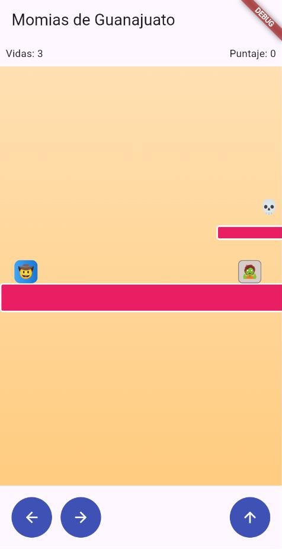
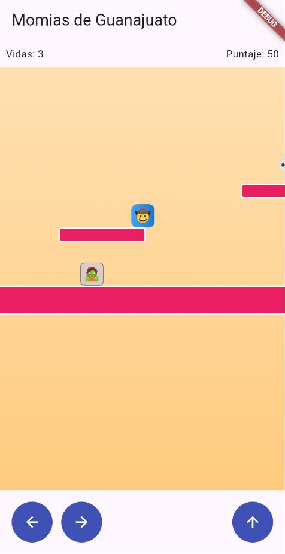
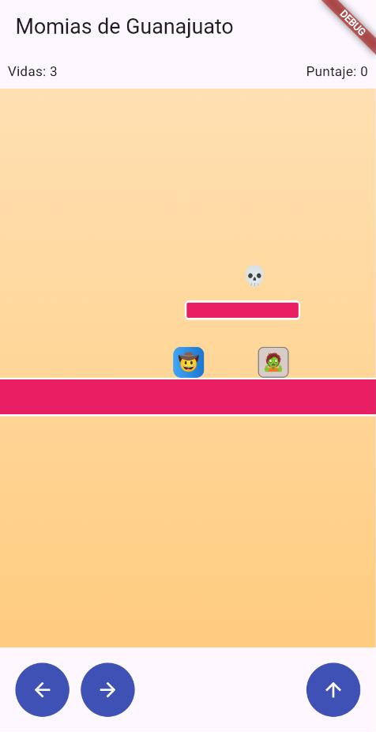
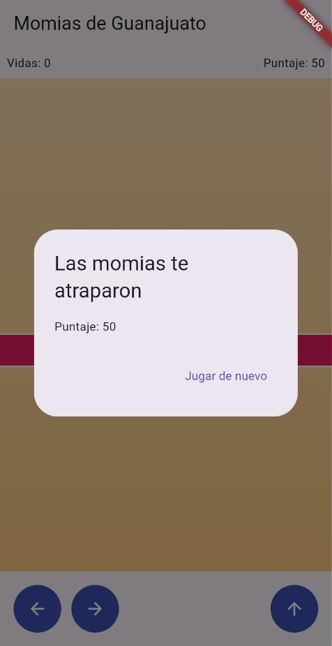

# Momias de Guanajuato: La Leyenda

Juego de plataformas con física real, desarrollado en Flutter/Dart siguiendo Desarrollo Guiado por Pruebas (TDD).

Proyecto complementario de práctica TDD para la materia Desarrollo Móvil Integral.
Ingeniería en Desarrollo y Gestión de Software (GIDS6092), Universidad Tecnológica del Norte de Guanajuato.

## Capturas

| Inicio del nivel | Salto a la plataforma | Momia patrullando | Fin de la partida |
|:---:|:---:|:---:|:---:|
|  |  |  |  |

Capturas tomadas en el navegador con `flutter run -d web-server`, en una vista de 390 x 760 px (tamaño de un celular).

## Descripción

Un explorador debe cruzar los callejones de Guanajuato saltando entre plataformas, esquivando o derrotando momias que patrullan de un lado a otro y recolectando calaveritas de azúcar, hasta llegar al Callejón del Beso.

A diferencia de un juego por turnos, un plataformas se actualiza alrededor de 60 veces por segundo. Aun así, toda la física y las reglas del juego están escritas como funciones puras de Dart y se probaron con TDD antes de construir la interfaz en Flutter.

### Mecánicas

- El personaje cae por gravedad y aterriza sobre las plataformas.
- Los botones en pantalla lo mueven a la izquierda o a la derecha y lo hacen saltar.
- Las momias patrullan entre dos límites fijos e invierten su dirección al llegar a ellos.
- Caer encima de una momia la derrota; chocar de lado con ella le quita una vida al jugador.
- Cada calaverita recolectada suma 50 puntos.
- Llegar al final del nivel gana la partida; quedarse sin vidas (se empieza con 3) la pierde.

### Controles

| Botón | Acción |
|---|---|
| Izquierda / Derecha (mantener presionado) | Caminar |
| Arriba | Saltar (solo si el personaje está en el suelo) |

## Estructura del proyecto

```
lib/
  logica/                      Dart puro, sin dependencias de Flutter
    rectangulo.dart            colisión AABB
    personaje.dart             posición, velocidad vertical y estado en el suelo
    momia.dart                 patrullaje entre dos límites
    calaverita.dart            objeto coleccionable
    motor_fisica.dart          gravedad, salto, aterrizaje, límites y meta
    motor_combate.dart         pisotón contra golpe lateral
    estado_juego.dart          jugando / ganado / perdido
    motor_juego.dart           coordina todas las reglas en cada cuadro
  presentation/
    juego_screen.dart          cámara, sprites y controles
  main.dart
test/
  rectangulo_test.dart
  motor_fisica_test.dart
  momia_test.dart
  motor_combate_test.dart
  motor_juego_test.dart
```

Toda la carpeta `lib/logica/` es Dart puro. En un juego con física a 60 cuadros por segundo los errores son difíciles de detectar a simple vista, por lo que es donde las pruebas aportan más valor.

### Arquitectura

```
JuegoScreen (Flutter)  --- cada 16 ms --->  MotorJuego.mover(dx)
cámara, sprites, UI    <--- setState -----  estado del juego
                                                  |
        +----------------+----------------+-------+------------------+
        |                |                |                          |
   MotorFisica      MotorCombate    Momia.patrullar      recolectarSiCorresponde
   gravedad,        pisotón vs      patrullaje de        calaveritas
   salto, piso      golpe           ida y vuelta
        |                |                |                          |
        +----------------+--- Rectangulo.intersectaCon (AABB) -------+
```

La interfaz no decide colisiones ni puntajes; solo dibuja el estado de `MotorJuego`.

## Desarrollo con TDD: las 10 rondas

Cada ronda siguió el ciclo rojo-verde: primero se escribe una prueba que falla y después el código mínimo para que pase.

| Ronda | Tema | Archivo de prueba | Implementación |
|:---:|---|---|---|
| 1 | Colisión AABB | `rectangulo_test.dart` | `Rectangulo.intersectaCon` |
| 2 | Gravedad y salto | `motor_fisica_test.dart` | `MotorFisica.aplicarGravedad`, `saltar` |
| 3 | Aterrizar sobre una plataforma | `motor_fisica_test.dart` | `MotorFisica.resolverColisionConPiso` |
| 4 | Movimiento horizontal con límites | `motor_fisica_test.dart` | `MotorFisica.moverHorizontal` |
| 5 | Patrullaje de la momia | `momia_test.dart` | `Momia.patrullar` |
| 6 | Combate: pisotón contra golpe | `motor_combate_test.dart` | `MotorCombate.resolverColision` |
| 7 | Recolectar calaveritas | `motor_juego_test.dart` | `MotorJuego.recolectarSiCorresponde` |
| 8 | Detectar la meta | `motor_fisica_test.dart` | `MotorFisica.haLlegadoALaMeta` |
| 9 | Vidas y fin del juego | `motor_juego_test.dart` | `MotorJuego._perderVida` |
| 10 | Bucle que integra todo | `motor_juego_test.dart` | `MotorJuego.mover` |

### Ronda 1: colisión entre rectángulos (AABB)

Dos rectángulos se traslapan si lo hacen en el eje X y en el eje Y al mismo tiempo. Este algoritmo (Axis-Aligned Bounding Box) es la base de casi toda la detección de colisiones en 2D, y en el juego se usa para todas las colisiones: piso, momias y calaveritas.

```dart
bool intersectaCon(Rectangulo otro) {
  return x < otro.x + otro.ancho &&
      x + ancho > otro.x &&
      y < otro.y + otro.alto &&
      y + alto > otro.y;
}
```

### Ronda 2: gravedad y salto

En cada cuadro, `gravedad = 0.8` se suma a la velocidad vertical. El impulso `impulsoSalto = -12` solo se aplica si el personaje está en el suelo, para que no pueda saltar en el aire.

### Ronda 3: aterrizar sobre una plataforma

`resolverColisionConPiso` recibe `yAnterior`, la posición del personaje en el cuadro anterior. Sin ese dato no hay forma de distinguir si el personaje viene cayendo desde arriba o si ya estaba atravesando la plataforma por dentro. `yAnterior` funciona como un parámetro-costura, igual que el `Random` inyectado en el proyecto Nieves 2048.

### Ronda 4: movimiento horizontal con límites

`moverHorizontal` desplaza al personaje y lo mantiene dentro del rango `[0, anchoNivel - ancho]`.

### Ronda 5: patrullaje de la momia

Es la inteligencia artificial más simple posible: un recorrido de ida y vuelta. Aun así merece pruebas, porque un error de signo (`+` en lugar de `-`) pasa desapercibido a simple vista y solo se nota después de jugar varios minutos.

### Ronda 6: combate

```dart
final cayendoSobreLaMomia = personaje.velocidadY > 0 &&
    (personaje.y + personaje.alto) <= (momia.y + momia.alto / 2);
```

Para que cuente como pisotón no basta con que el personaje esté cayendo (`velocidadY > 0`); también se exige que su pie esté en la mitad superior de la momia. Sin esa segunda condición, un choque lateral mientras el personaje ya iba cayendo contaría como una momia derrotada. Al pisarla, el personaje rebota con la mitad del impulso de salto.

### Ronda 7: recolectar calaveritas

Cada calaverita da 50 puntos y se marca como `recolectada`, de modo que no vuelve a sumar.

### Ronda 8: detectar la meta

`haLlegadoALaMeta` devuelve verdadero cuando `personaje.x >= posicionMeta`.

### Ronda 9: vidas

Un golpe lateral resta una vida y regresa al personaje a su posición inicial. Al llegar a 0 vidas, el estado cambia a `EstadoJuego.perdido`.

### Ronda 10: MotorJuego.mover()

```dart
void mover(double deltaX) {
  if (estado != EstadoJuego.jugando) return;
  final yAnterior = personaje.y;
  MotorFisica.moverHorizontal(personaje, deltaX, anchoNivel);   // 1. física
  MotorFisica.aplicarGravedad(personaje);
  MotorFisica.resolverColisionConPiso(personaje, plataformas, yAnterior);
  for (final momia in momias) {                                 // 2. combate
    momia.patrullar();
    if (MotorCombate.resolverColision(personaje, momia) ==
        ResultadoColisionMomia.jugadorGolpeado) {
      _perderVida();
      return;
    }
  }
  puntaje += recolectarSiCorresponde(personaje, calaveritas);   // 3. recolección
  if (MotorFisica.haLlegadoALaMeta(personaje, posicionMeta)) {  // 4. meta
    estado = EstadoJuego.ganado;
  }
}
```

`mover()` es el único lugar que decide el orden de las reglas: primero física y piso, luego momias, luego calaveritas y al final la meta. Ese orden importa y queda documentado en el propio código, respaldado por las pruebas de las rondas anteriores.

### Prueba de integración

La prueba `llegar a la meta cambia el estado a ganado` confirma que el movimiento, la física y la detección de la meta funcionan en conjunto, sin necesidad de simular cientos de cuadros de animación.

## Interfaz gráfica

- Cámara: `camaraX` centra al personaje en la ventana visible y se limita con `clamp` para no mostrar zonas fuera del nivel. Cada objeto se dibuja en su posición real menos `camaraX`, por lo que todo el escenario se desplaza cuando el personaje avanza.
- Plataformas: color rosa (`#E91E63`), en referencia a las fachadas de Guanajuato.
- Sprites: el personaje, las momias y las calaveritas se dibujan con emojis dentro de contenedores de color.
- Bucle: un `Timer.periodic` de 16 ms (aproximadamente 60 FPS) llama a `MotorJuego.mover`.
- Fin de partida: un diálogo animado (`ScaleTransition` con `Curves.elasticOut`) muestra el puntaje y el botón "Jugar de nuevo".

## Cómo ejecutarlo

Requisito: [Flutter](https://docs.flutter.dev/get-started/install) con SDK de Dart ^3.13.

```bash
git clone https://github.com/SekiroK5/momias_guanajuato.git
cd momias_guanajuato
flutter pub get

# Ejecutar las pruebas (23 pruebas)
flutter test

# Ejecutar el juego
flutter run -d chrome      # en el navegador
flutter run                # en un emulador o dispositivo conectado
```

## Correcciones respecto al manual

Al ejecutar las pruebas tal como venían en el manual, dos de ellas fallaban por los datos de la prueba y no por la lógica del juego. Además, la pantalla no compilaba por un `const`. Cada corrección tiene un comentario en el código.

| Archivo | Prueba | Problema | Corrección |
|---|---|---|---|
| `motor_fisica_test.dart` | el personaje aterriza sobre una plataforma al caer sobre ella | Con `y: 90` y `yAnterior: 85`, el pie anterior (85 + 32 = 117) ya estaba debajo de la plataforma (y = 100), así que el personaje no venía cayendo desde arriba. | `y: 70` y `yAnterior: 65`: el pie pasa de 97 a 102 y cruza el borde de la plataforma. |
| `motor_combate_test.dart` | caer sobre la mitad superior de una momia la derrota | Con `y: 68`, el pie queda exactamente en y = 100, el borde superior de la momia. AABB no cuenta como colisión dos bordes que solo se tocan. | `y: 70`: el pie (102) se traslapa con la momia y sigue dentro de su mitad superior (hasta 116). |
| `juego_screen.dart` | No aplica | `const [Calaverita(...)]` no compila, porque `Calaverita` tiene un campo mutable (`recolectada`) y no tiene constructor `const`. | Se quitó `const` de esa lista. |

## Lista de verificación TDD

- [x] La colisión AABB (`Rectangulo`) se probó de forma aislada antes de usarse en cualquier otra parte.
- [x] `resolverColisionConPiso` usa la posición anterior del personaje, no solo la actual.
- [x] El criterio de pisotón exige que el personaje esté cayendo y en la mitad superior de la momia, no solo que la toque.
- [x] `patrullar()` y el resto de la lógica sensible al tiempo son deterministas en las pruebas.
- [x] `MotorJuego.mover()` es el único lugar que decide el orden de física, combate, recolección y meta.
- [x] La interfaz no decide colisiones ni puntajes; solo dibuja el estado de `MotorJuego`.

## Retos de extensión

- [ ] Colisión lateral del personaje contra las plataformas, para no atravesarlas de costado, usando el mismo patrón de costura de `resolverColisionConPiso`.
- [ ] Mostrar las vidas como corazones en el HUD en lugar de un número.
- [ ] Una momia que patrulle verticalmente reutilizando la clase `Momia` con `limiteArriba` y `limiteAbajo`.
- [ ] Guardar el mejor puntaje con `shared_preferences`.
- [ ] Un segundo nivel más largo, con más plataformas y momias, usando el mismo `MotorJuego`.

## Autor

Noé Chavero ([@SekiroK5](https://github.com/SekiroK5))
